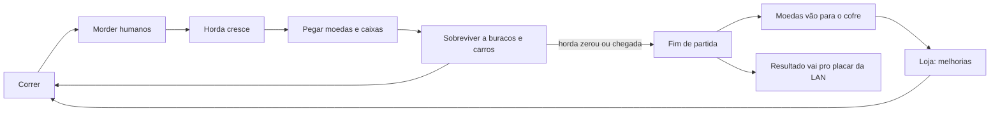
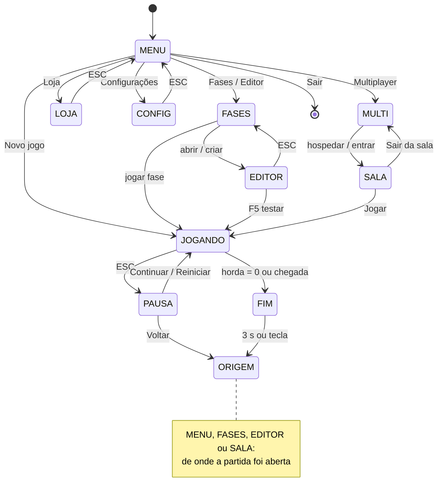
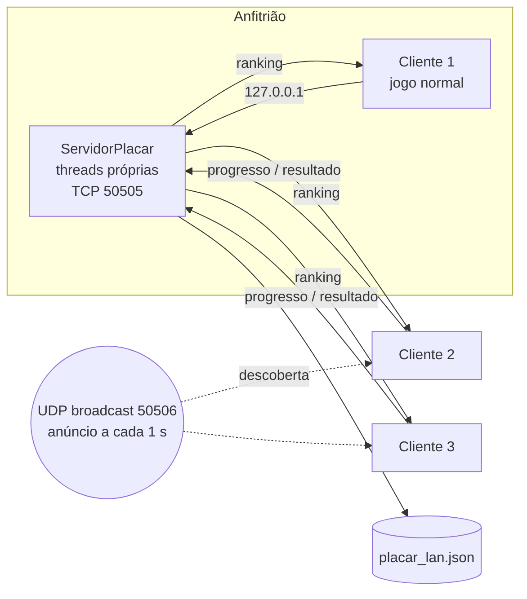
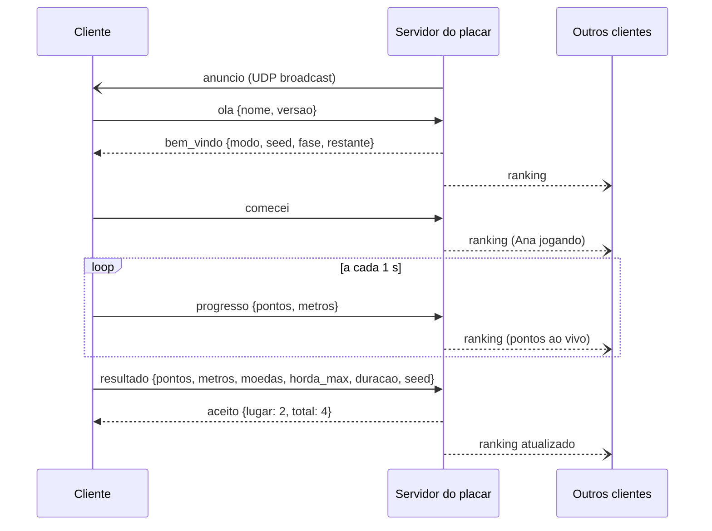
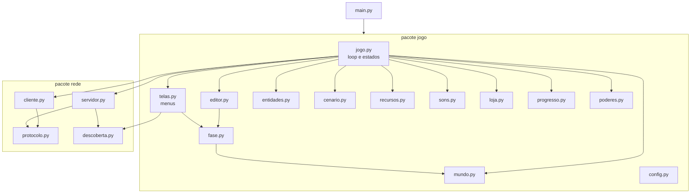
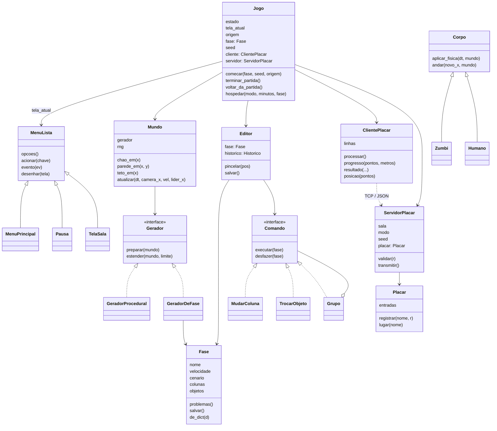
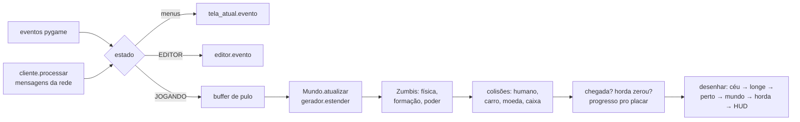

# Zumbi Tsunami 2D — Game Design Document

**Disciplina:** Tópicos Avançados em Computação III
**Versão:** 2.0 (entrega final) — 22/11/2026
**Apresentação final:** 24/11/2026 · relatório em PDF via Classroom
**Tecnologia:** Python 3 + pygame-ce 2.5.8 (rede só com a biblioteca padrão)

> Tudo o que este documento descreve está implementado no código (`jogo/`, `rede/`).
> A seção 10 lista o que ficou de fora.

---

## 1. Visão geral

| Item | Descrição |
|------|-----------|
| Gênero | Runner 2D de rolagem lateral (modo infinito + fases feitas no editor) |
| Plataforma | Desktop (Windows, macOS, Linux) |
| Público | Casual, 10+ anos |
| Sessão | Partidas de 1 a 5 minutos |
| Pitch | Você não controla um zumbi, controla **uma horda**. Morda as pessoas da rua para engordar a horda, pule buracos, atropele carros e chegue o mais longe possível. |

### 1.1 Pilares de design

1. **Crescer é a recompensa** — cada mordida aparece na tela como mais um zumbi correndo.
2. **Um botão só** — toda a horda pula junta; a profundidade vem do tempo do pulo.
3. **Caos controlado** — poderes curtos e exagerados (gigante, dragão, balão, ímã).
4. **Sempre mais uma partida** — moedas viram melhorias na loja; o placar da LAN vira disputa.

---

## 2. Jogabilidade

### 2.1 Loop principal



### 2.2 Controles

| Entrada | Ação |
|---------|------|
| `ESPAÇO` / `W` / `↑` / clique | pular (a horda inteira) |
| soltar cedo | pulo curto |
| `M` | liga/desliga os sons |
| `ESC` | pausa (Continuar · Reiniciar · Voltar) |

### 2.3 Mecânicas

- **Horda:** começa com 1 zumbi (mais com a loja), até 80, em formação de 5 linhas.
- **Contágio:** encostar num humano o converte (+1). 8 tipos de pessoa.
- **Obstáculos:** carros com 1 a 4 de vida; cada zumbi que bate morre e tira 1 de vida.
- **Buracos:** plataformas em 3 alturas, buracos dimensionados pelo alcance do pulo
  (`velocidade × tempo_no_ar`). Quem cai bate na parede da plataforma seguinte.
- **Dificuldade:** no infinito a velocidade sobe de 330 para 700 px/s; numa fase ela é fixa (escolhida no editor).
- **Pulo:** coyote time (0,10 s), buffer de entrada (0,12 s) e pulo variável.
- **Pontuação:** metros + moedas × 5; numa fase, cruzar a chegada soma **10 pontos por zumbi vivo**.
  Recorde (só do infinito) salvo em `progresso.json`.
- **Cenários:** cidade → deserto → floresta → neve, trocando dentro de um túnel a cada 250 m
  (uma fase escolhe em qual começa).

### 2.4 Poderes (caixas a cada 100 m no infinito; onde o autor quiser numa fase)

| Poder | Duração | Efeito |
|-------|---------|--------|
| Gigante | 9 s | horda vira um zumbi enorme que atropela carros |
| Dragão | 7,5 s | voo livre, queima carros, passa por cima de buracos |
| Balão | 9 s | gravidade em 55% + pulo duplo |
| Ímã | 11 s | puxa moedas num raio de 320 px, valem em dobro |

### 2.5 Loja e progressão

| Item | Preço | Efeito |
|------|-------|--------|
| Horda inicial | 100/250/500/900 | +1 zumbi inicial por nível |
| Poder duradouro | 150/350/700 | +15% de duração por nível |
| Segunda chance | 120 (até 3) | volta voando com 3 zumbis |
| Abóbora / Dino / Robô | 200/350/500 | libera monstros (40% das mordidas) |

Moedas de **fase** não vão para o cofre — senão bastava montar uma fase cheia de moedas.

---

## 3. Menus e fluxo de telas

### 3.1 Árvore de menus

| Tela | Opções |
|------|--------|
| **Tela inicial** | Novo jogo · Fases · Editor de fases · Multiplayer (placar LAN) · Loja · Configurações · Sair |
| **Novo jogo** | partida no modo infinito |
| **Fases** | lista de `fases/*.json` (nome, metros, velocidade) · Voltar |
| **Editor de fases** | + Criar fase nova · fases salvas (abre no editor) · Voltar |
| **Multiplayer** | Hospedar placar livre · Hospedar desafio (‹ minutos ›) · Desafio na fase (‹ fase ›) · salas achadas na rede · Entrar por IP · Voltar |
| **Sala** | ranking ao vivo · Jogar · Sair da sala |
| **Loja** | itens, cofre, voltar |
| **Configurações** | Efeitos sonoros · Música tema · Volume (‹ 0–100% ›) · Tela cheia · Nome no placar · Zerar progresso (pede confirmação) · Voltar |
| **Pausa** (ESC na partida) | Continuar · Reiniciar · Voltar (ao menu, às fases, ao editor ou à sala, conforme a origem) |
| **Fim de partida** | “FIM DE JOGO” ou “FASE CONCLUÍDA!”, placar 3 s, volta para a origem |

Navegação padrão em todas as telas: setas/mouse escolhem, `←`/`→` ajustam valores,
`ENTER`/`ESPAÇO`/clique confirmam, `ESC` volta. Campos de texto (nome, IP) aceitam digitação.

### 3.2 Diagrama de estados



Estados em `jogo/jogo.py`: `MENU`, `LOJA`, `JOGANDO`, `FIM`, `PAUSA`, `CONFIG`, `FASES`,
`EDITOR`, `MULTI`, `SALA`. Cada tela de menu é um objeto de `jogo/telas.py`; o teste de fase e a
partida na sala reaproveitam o `JOGANDO` normal, só muda a **origem**.

---

## 4. Editor de fases

### 4.1 Objetivo

O jogador monta uma fase **finita** (com linha de chegada), salva em arquivo e joga — sozinho
(menu Fases) ou como **desafio do placar da LAN**. O modo infinito continua procedural.

### 4.2 Modelo: grade de colunas

A fase é uma grade de colunas de **40 px**. Cada coluna tem um nível de chão (0, 1 ou 2 — as
mesmas três alturas do modo infinito) ou é **buraco** (−1). Em cima de cada coluna cabe um objeto:
carro, humano, moeda ou caixa. Tamanho de 60 a 900 colunas (48 a 720 m; padrão 320 m).

Colunas **travadas** (sempre chão reto, sem carro): a **largada** (10 primeiras) e o trecho do
**túnel** de troca de cenário a cada 250 m — o editor pinta essas áreas de azul.

### 4.3 Interface

```
┌──────────────────────────────────────────────────────────────────┐
│ [1 CHÃO][2 BURACO][3 CARRO][4 HUMANO][5 MOEDA][6 CAIXA][7 APAGAR]│ ← paleta
├──────────────────────────────────────────────────────────────────┤
│   prévia do jogo de verdade + grade de 40 px + marcas a cada 20 m│
│   guias tracejadas dos 3 níveis · arco do pulo na coluna do mouse│
│   trechos impossíveis em vermelho · mastro da CHEGADA            │
├──────────────────────────────────────────────────────────────────┤
│ [N] nome  [V] vel 450  [C] cidade  [+/-] 320 m  Ctrl+Z/Y  Ctrl+S │ ← barra
│ dica / erro do trecho sob o mouse                                │
└──────────────────────────────────────────────────────────────────┘
```

| Ação | Entrada |
|------|---------|
| escolher peça | clique na paleta ou teclas `1`–`7` |
| colocar | clique esquerdo; **arrastar pinta** (chão, buraco, moedas) |
| altura do chão | a altura do mouse escolhe o nível |
| mudar carro / caixa | clicar de novo no objeto: vida 1→4 / próximo poder |
| apagar | clique direito (ou peça 7); em buraco, tapa com chão |
| rolar | `←`/`→`/`A`/`D` (`SHIFT` acelera), roda do mouse, `Home`/`End` |
| nome · velocidade · cenário · tamanho | `N` · `V` · `C` · `+`/`−` |
| desfazer / refazer | `Ctrl+Z` / `Ctrl+Y` (ou `Ctrl+Shift+Z`) |
| salvar / testar | `Ctrl+S` / `F5` (`ESC` na pausa volta ao editor no mesmo ponto) |
| sair | `ESC` (se não salvou, pede `ESC` de novo) |

### 4.4 Validações

Usam a mesma conta do mundo procedural: `alcance = velocidade × TEMPO_NO_AR`,
com `TEMPO_NO_AR = 2·|VEL_PULO| / GRAVIDADE`.

| Situação | Limite |
|----------|--------|
| buraco, próxima plataforma no mesmo nível | até 0,55 × alcance |
| buraco, próxima plataforma mais baixa | até 0,60 × alcance |
| buraco, próxima plataforma 1 nível acima | até 0,25 × alcance |
| subida de 2 níveis (com ou sem buraco) | impossível (o pulo sobe ~173 px; 2 níveis são 220 px) |

Trecho que passa do limite fica **vermelho**, a barra explica o porquê e o **salvamento é
bloqueado** (testar continua liberado). Carro não entra em buraco, largada nem túnel.

### 4.5 Formato do arquivo (`fases/<nome>.json`)

```json
{
  "versao": 1,
  "nome": "Avenida do Caos",
  "autor": "Zumbi Tsunami",
  "cenario": "cidade",
  "velocidade": 450,
  "colunas": [0, 0, 0, -1, -1, 1, 1, 1, 0, ...],
  "objetos": [
    {"tipo": "humano", "col": 12},
    {"tipo": "carro", "col": 40, "vida": 2},
    {"tipo": "moeda", "col": 52, "y": 300},
    {"tipo": "caixa", "col": 22, "poder": "gigante"}
  ]
}
```

O fim da última coluna é a chegada. Ao ler, `Fase.de_dict` limpa tudo (níveis, tipos, vida,
poder, altura das moedas), então um arquivo mexido à mão ou recebido pela rede não derruba o jogo.
O repositório traz uma fase pronta: `fases/avenida_do_caos.json`.

### 4.6 Integração com o código

O `Mundo` não gera mais o terreno sozinho: ele recebe um **gerador** (Strategy).

- `GeradorProcedural` (`jogo/mundo.py`) — as regras do modo infinito, agora com semente própria
  (`random.Random(seed)`) e velocidade calculada pela posição, para a mesma semente dar o mesmo mapa.
- `GeradorDeFase` (`jogo/fase.py`) — junta colunas iguais em `Segmento`s, cria `Obstaculo`, `Humano`,
  `Moeda` e `Box` a partir dos objetos e, depois da chegada, estende chão reto.

O resto (física, colisão, desenho, câmera) não mudou, porque já conversava com o `Mundo` por
`chao_em`, `parede_em` e `teto_em`. A prévia do editor é um `Mundo` com o `GeradorDeFase`
desenhado pelo mesmo código da partida.

---

## 5. Multiplayer em LAN: Placar da Rede (cliente e servidor)

### 5.1 Ideia

O Zumbi Tsunami é um jogo de **uma horda só**, e dividir a tela ou o mapa quebraria isso. Por isso
o multiplayer não coloca jogadores na mesma partida: coloca todos no **mesmo placar**. Cada pessoa
joga a sua partida no seu computador, e as pontuações vão para um **ranking compartilhado por todos
que estão na LAN**, atualizado ao vivo.

- **Placar livre:** qualquer partida no modo infinito entra no ranking da sala (vale a melhor de cada um).
- **Desafio da sala:** o anfitrião escolhe o tempo (2 a 60 min) e uma **semente** sorteada ou uma
  **fase do editor** (o servidor manda a fase inteira para os clientes). Todos jogam o **mesmo mapa**.
- **Ao vivo:** o HUD mostra “2º de 4 na sala — faltam 174 pts pra passar Bruno”; na sala, quem está
  jogando aparece com os pontos da partida em andamento.

### 5.2 Arquitetura



- **Servidor** (`rede/servidor.py`): uma thread aceita conexões e uma thread atende cada cliente.
  Só ele mexe no ranking; valida cada resultado e reenvia o ranking a todos a cada mudança.
- **Cliente** (`rede/cliente.py`): a conversa com a rede fica numa thread; o jogo só chama
  `processar()` uma vez por quadro. Se a conexão cair, a partida segue e o cliente tenta
  reconectar a cada 2 s, reenviando o resultado pendente.
- **Descoberta** (`rede/descoberta.py`): o anfitrião anuncia a sala por broadcast UDP (e pelo
  127.0.0.1, para quem joga na mesma máquina); a tela Multiplayer lista as salas ouvidas nos
  últimos 3,5 s. Também dá para entrar digitando o IP.
- **Persistência:** o anfitrião grava `placar_lan.json` (chave = sala + modo + semente/fase);
  reabrir a mesma sala recupera o ranking.
- **Nomes repetidos** ganham sufixo (“Ana 2”). Só biblioteca padrão: `socket`, `threading`, `json`, `queue`.

### 5.3 Telas

| Tela | Conteúdo |
|------|----------|
| Multiplayer | hospedar (livre / desafio com tempo / desafio numa fase), salas achadas, IP manual |
| Sala | nome da sala, modo, tempo que falta, IP do anfitrião; top 10: posição, nome, pontos, metros, maior horda, “jogando: N pts”; Jogar · Sair |
| HUD na partida | posição atual e quanto falta para passar o próximo |
| Fim de partida | “Seu resultado entrou: 2º de 4 — novo recorde seu!” (ou o motivo da recusa) |

### 5.4 Protocolo (`rede/protocolo.py`: JSON, uma mensagem por linha)

| Direção | Mensagem | Campos |
|---------|----------|--------|
| S → LAN (UDP) | `anuncio` | `assinatura`, `sala`, `porta`, `modo`, `jogadores`, `ip`, `versao` |
| C → S | `ola` | `nome`, `versao` |
| S → C | `bem_vindo` | `id`, `nome` (já sem repetição), `sala`, `modo`, `seed`, `fase`, `restante` |
| S → C | `ranking` | `sala`, `modo`, `restante`, `linhas` `{nome, pontos, metros, moedas, horda_max, jogando, agora}` |
| C → S | `comecei` | — |
| C → S | `progresso` | `pontos`, `metros` (a cada 1 s) |
| C → S | `resultado` | `pontos`, `metros`, `moedas`, `horda_max`, `duracao`, `seed`, `fase` |
| S → C | `aceito` / `recusado` | `lugar`, `total`, `recorde` / `motivo` |
| S → C | `erro` | `motivo` (versão diferente, sala fechada) |
| C → S | `tchau` | — |

**Validação no servidor:** recusa resultado incompleto ou negativo, `metros > duração × 700 / 50 + 20`
(mais rápido que a velocidade máxima), horda acima de 80, pontos que não batem com
`metros + moedas × 5 + bônus de chegada`, e — no desafio — outra semente/fase ou envio mais de
60 s depois do fim.

### 5.5 Diagrama de sequência



---

## 6. Padrões de projeto

| Padrão | Onde | Para quê |
|--------|------|----------|
| **Game Loop** | `Jogo.rodar` | entrada → `atualizar(dt)` → desenhar, a 60 FPS |
| **State** | `Jogo.estado` + uma classe por tela em `jogo/telas.py` (`MenuPrincipal`, `Pausa`, `Configuracoes`, `TelaFases`, `TelaMultiplayer`, `TelaSala`), todas com `evento` / `atualizar` / `desenhar` | o loop não sabe qual tela está ativa |
| **Template Method** | `MenuLista`: navegação, rolagem e desenho prontos; cada tela só define `opcoes()` e `acionar()` | menus novos com pouco código |
| **Update Method** | `atualizar(dt)` / `desenhar` em `Zumbi`, `Humano`, `Box`, `Moeda`, `Particula`, `Cenario` | cada entidade cuida de si |
| **Herança** | `Corpo` → `Zumbi`, `Humano` | física e `andar` num lugar só |
| **Type Object / Data-driven** | `poderes.FICHA`, `loja.ITENS`, `cenario.TEMAS` | novo poder/item/cenário é só uma entrada de dados |
| **Flyweight + Cache** | `recursos.py` | 80 zumbis = 80 blits, ~3 ms |
| **Singleton de módulo** | `progresso.dados`, `sons` | um progresso e um mixer |
| **Null Object / Fallback** | `sons` sem áudio vira no-op; sem `assets/` desenha formas | o jogo nunca cai por falta de recurso |
| **Strategy** | `Mundo(gerador)`: `GeradorProcedural` × `GeradorDeFase` | o `Mundo` não sabe de onde vem o terreno |
| **Command** | `MudarColuna`, `TrocarObjeto`, `MudarTamanho`, `Grupo` + `Historico` em `jogo/editor.py` | Ctrl+Z / Ctrl+Y; uma pincelada = um comando |
| **Composite** | `Grupo` é um comando feito de comandos | desfazer a pincelada inteira |
| **Factory (simples)** | `Fase.de_dict` e `GeradorDeFase.preparar`: dicionário → `Fase` → entidades | um lugar só para (de)serializar arquivo e rede |
| **Client-Server** | `rede/servidor.py`, `rede/cliente.py` | o servidor é a única fonte do ranking |
| **Observer / Publish-Subscribe** | servidor reenvia `ranking` a todos a cada mudança | ranking ao vivo |
| **Proxy remoto** | `ClientePlacar.resultado()` / `progresso()` / `posicao()` | a partida usa o placar como se fosse local |
| **Producer-Consumer** | thread da rede → `queue.Queue` → `processar()` no quadro | rede sem travar o jogo e sem disputa de dados |

---

## 7. Diagramas de apoio

### 7.1 Pacotes



### 7.2 Classes



### 7.3 Ciclo de um quadro



---

## 8. Arte e som

- **Personagens:** pacotes CC0 do GameArt2D, montados em folhas de 8 quadros de 160 px (`ferramentas/importar_sprites.py`).
- **Ícones:** game-icons.net (CC BY 3.0). Créditos completos em `CREDITOS.md`.
- **Fundos:** 4 cenários × 3 camadas em SVG gerado por código (`ferramentas/gerar_fundos.py`) + túnel.
- **Música tema:** “Spooky Action Loop (Hallow Quest)”, de Zane Little (CC0), em loop.
- **Sons:** baixados da web, todos CC0 (OpenGameArt e Kenney): passos da horda (loop que cresce com a horda), mordida, gemidos de zumbi, gritos dos humanos, batida e carro quebrando, explosão, pulo, moeda, poder, fim e clique. `ferramentas/importar_sons.py` recorta, mistura e normaliza; variações (`grito_1`, `grito_2`...) são sorteadas. A primeira versão tinha 9 sons sintetizados por código (`ferramentas/gerar_sons.py`).

---

## 9. Cronograma

| Data | Marco |
|------|-------|
| 16/11/2026 | Fundos, túnel, buracos, sons, loja, poderes com visual novo |
| 22/11/2026 | GDD 2.0 + editor de fases, placar LAN, menus novos (pausa, configurações, fases) |
| 24/11/2026 | **Apresentação final** · relatório final em PDF no Classroom |

## 10. Fora do escopo / próximos passos

- Testar o placar em duas máquinas da rede da faculdade (o broadcast pode ser bloqueado pelo
  roteador ou firewall; nesse caso use **Entrar por IP**).
- Tela de créditos dentro do jogo (hoje os créditos estão em `CREDITOS.md`).
- Sprites de carros e moedas, eventos do jogo via Observer (hoje sons e partículas são chamados direto).
